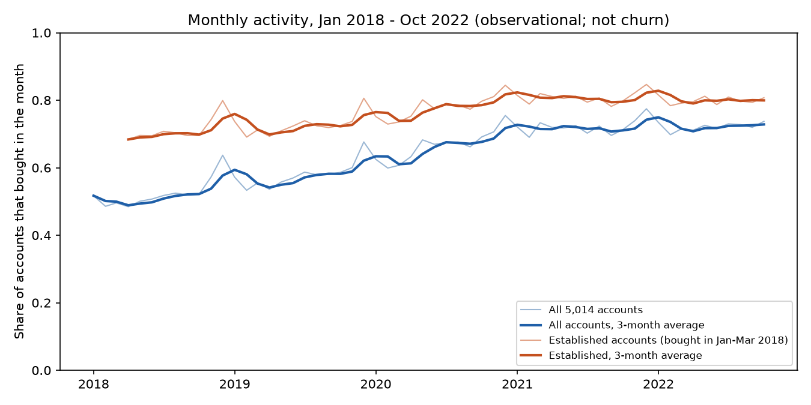
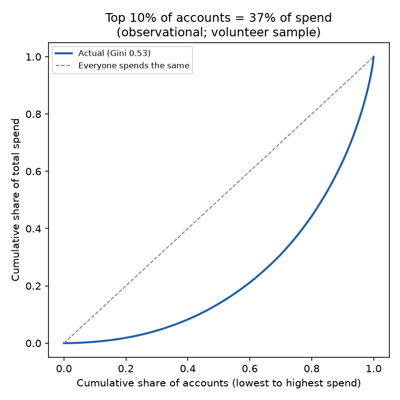
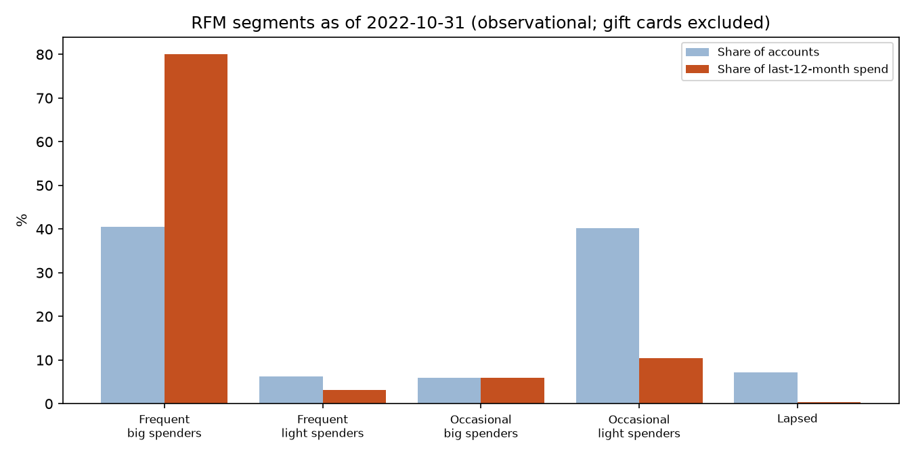
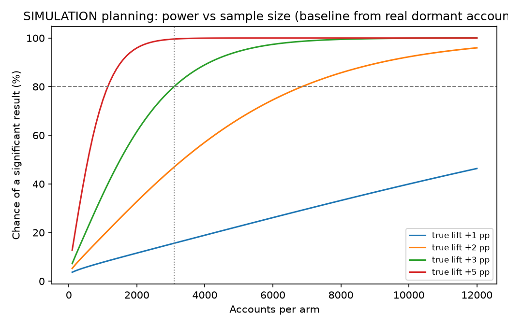
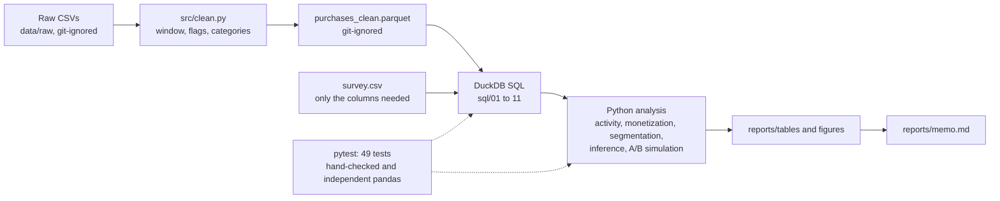

# Retail behaviour analytics: activity, spend, segments and an A/B test design

A product-analytics project on 5,014 volunteer Amazon accounts (Jan 2018 to Oct 2022). It covers monetization, activity over time, explainable RFM segments, confidence intervals, hypothesis tests, and a **simulated** A/B test with a known planted effect. A one-page memo for a product manager is in [`reports/memo.md`](reports/memo.md).

**How to read the labels**
- **Descriptive:** counts and shares in this sample.
- **Observational:** patterns we watched, not caused. Nothing here shows that any action would change them.
- **Exploratory:** checked, with known weaknesses, no strong claim.
- **SIMULATION:** made-up experiment built on real baseline behaviour. It checks the method. It says nothing about real customers.

## Findings

| Finding | Number (95% bootstrap interval) | Label |
|---|---|---|
| Frequent big spenders (40.5% of accounts) make this share of last-12-month spend | 80.0% (78.8% to 81.2%) | Descriptive |
| Top 10% of accounts make this share of total spend | 36.6% (35.6% to 37.6%); Gini 0.533 | Descriptive |
| Share of accounts buying in a typical Apr to Oct month, 2018 to 2022 | 51% to 72%; among accounts already buying in early 2018, 70% to 80% | Observational |
| Jan to Oct spend per account, 2022 vs 2018 (current dollars, not inflation-adjusted) | 2.10x (2.02x to 2.19x), $818 to $1,720 | Observational |
| Quiet for 3 months, then buys again in a given month | 21.6% (20.9% to 22.3%) | Observational |
| RFM segments stable one year apart | 67.3% stayed in segment vs 33.8% by chance; kappa 0.51 | Descriptive |
| Moved or lost a job in 2021 vs lapsing by Oct 2022 | No detectable difference (+0.1 and +0.5 percentage points, intervals include 0) | Exploratory |
| Shared vs single-person accounts, median spend | $9,830 vs $3,772 (Cliff's delta 0.46). Mostly mechanical: more people on an account buy more. | Observational |
| Planned A/B size to detect +3 points (80% power, 5% significance) | 3,094 accounts per arm; about 10 months at current volume (rough) | SIMULATION |
| Method check over simulated experiments | Power 80.8%; false positives about 5% (5.1% over 3 x 5,000 runs); intervals cover the true lift about 95% | SIMULATION |
| Underpowered test (500 per arm) | Only 19.8% significant, and the winners overstate the lift (6.7 vs the true 3.0 points) | SIMULATION |

Charts are in `reports/figures/`, tables in `reports/tables/`.






## How it fits together



## Data

- **Source:** Open e-commerce 1.0 (Berke et al., Scientific Data 2024), Harvard Dataverse, DOI [10.7910/DVN/YGLYDY](https://doi.org/10.7910/DVN/YGLYDY). Licence shown on the dataset page: CC0 1.0.
- **Citation:** `<paste the text from the Dataverse "Cite Dataset" button>`
- **Not included here.** The raw files are not in this repo. They are 300 MB of real people's order histories, so `data/` is git-ignored. Download the three CSVs from the Dataverse page into `data/raw/`.
- **Privacy choices (mine, not licence terms):** survey health, substance-use, race, gender and sexual-orientation columns are never read; sensitive product categories (medication, incontinence, sexual wellness, alcohol and similar) are merged into one bucket; any group under 30 accounts is hidden; per-account files stay in git-ignored folders; no re-identification attempts.

## What was cleaned, and how much it changed

| Step | Effect |
|---|---|
| Analysis window 2018-01-01 to 2022-10-31 | Removes 113,659 rows (6.14%). Each person shared their history on their own day between Nov 2022 and Mar 2023, so only months up to Oct 2022 are complete for everyone. |
| Gift cards | 38,850 rows (2.10%) flagged and left out of spend and category numbers |
| Exact duplicates | 10,911 rows flagged and kept (no order ID, so a repeat buy can't be told from a double count) |
| Missing category | Labelled "Unknown", kept |

Base table: 1,698,208 rows, 5,014 accounts, $40,055,052 of spend. Metric definitions and what each can and cannot tell us: [`docs/metric_definitions.md`](docs/metric_definitions.md).

## What this data cannot support

- **It is a volunteer sample.** Ages 25 to 34 are 36% of accounts, and these accounts shop a lot (median 104 shopping days in 58 months). Intervals only measure noise inside the sample, not who volunteered.
- **No churn.** Everyone still had an Amazon account in late 2022, and everyone's history starts in Jan 2018, so a first purchase here is not acquisition. I report activity and reactivation, not retention.
- **No refunds or returns** are in the file. "Spend" is item price times quantity at purchase.
- **An account is not a person.** It can be a household. A 2021 life event may have hit someone else on the account, and blank answers are assumed to mean "no event", which can't be checked.
- **An "order" is a proxy:** one account's purchases on one day. There is no order ID.
- **Dollars are current, not inflation-adjusted.**
- **The A/B part is a simulation.** Group assignment and the effect are planted, repeat draws can include the same account in different months, and the guardrail rule ("not significantly lower revenue") is weaker than a proper non-inferiority margin. A real test would set that margin first.
- **Categories are Amazon product types** (1,872 of them), too granular for a clear mix.

## Reproduce it

```bash
python -m venv .venv
source .venv/Scripts/activate        # Windows Git Bash; on macOS/Linux use .venv/bin/activate
pip install -r requirements.txt
# put amazon-purchases.csv, survey.csv and fields.csv in data/raw/
python src/audit.py                  # data audit (prints counts only)
python -m src.audit2                 # impact of each cleaning choice
python -m src.clean                  # cleaning step, writes the parquet
python -m src.sql_metrics            # monthly metrics, per-account metrics
python -m src.activity               # established accounts, reactivation
python -m src.monetization           # concentration, category mix
python -m src.segmentation           # RFM segments
python -m src.inference              # bootstrap intervals, two tests
python -m src.ab_simulation          # SIMULATED A/B test
streamlit run app/streamlit_app.py   # dashboard, reads only reports/tables
pytest -q                            # 42 pass without the data (7 data-dependent tests skip)
RUN_REAL_DATA=1 pytest -q            # 49 pass with the data in place
```

Fixed seeds: bootstrap 42, simulation 2026. Python 3.11.

## How the numbers were checked

- Every SQL window-function query is cross-checked against an independent pandas loop. The real-data tests confirm earlier numbers still reproduce (5,014 accounts, $40,055,052, 7,531 reactivation events out of 34,930 quiet account-months).
- Effect sizes, the Holm correction, the sample-size formula and the Wilson interval are tested against hand-worked values or statsmodels.
- The simulation is tested for known behaviour: about 5% false positives with no effect, about 80% power at the planned size, intervals covering the true lift about 95% of the time, and winners overstating the lift when underpowered.

## Layout

```
sql/        DuckDB queries (01 to 11)
src/        load, clean, audit, activity, monetization, segmentation, inference, ab_simulation
app/        Streamlit dashboard (reads only the aggregate tables in reports/tables)
tests/      pytest, including real-data checks
reports/    memo.md, tables/, figures/
docs/       metric definitions, licence notes
```
